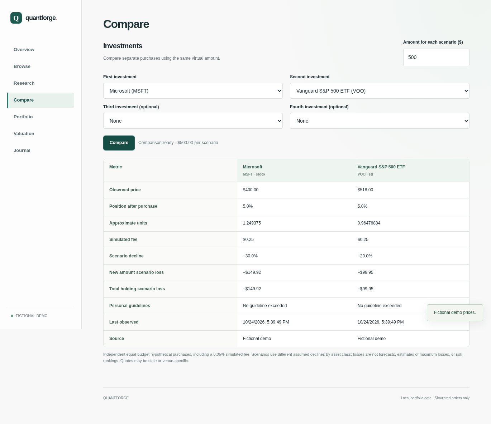
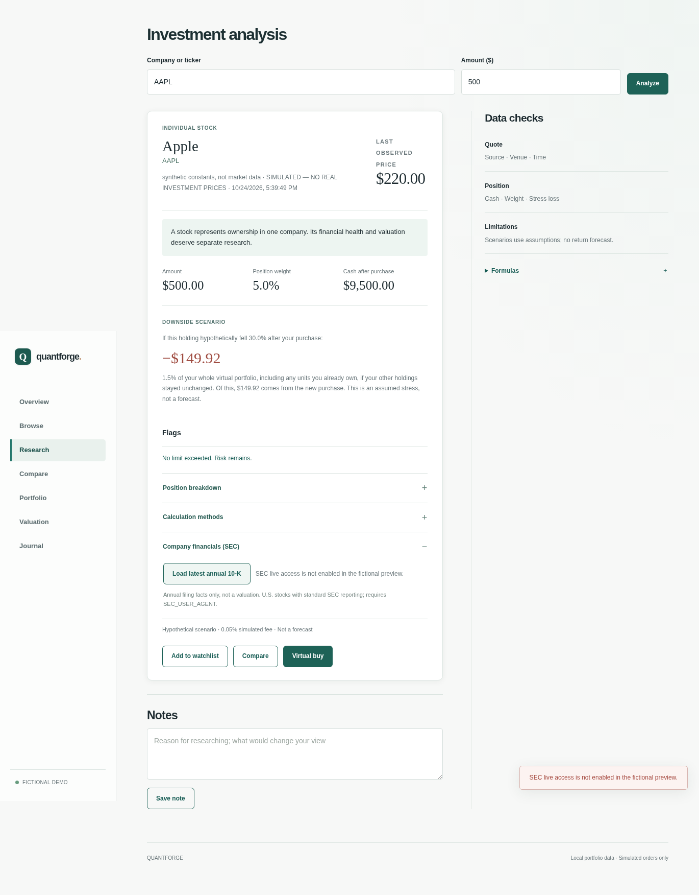
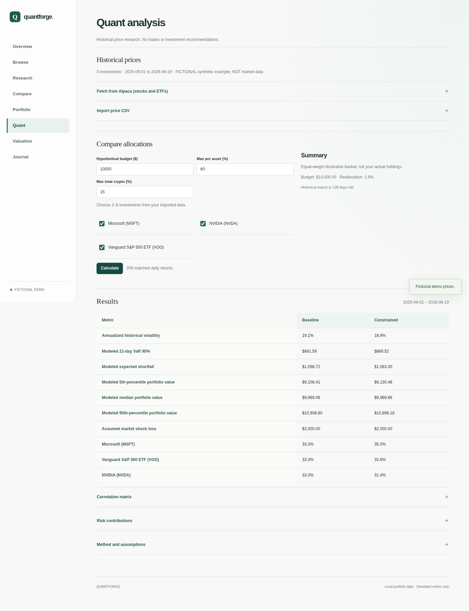

<!-- QuantForge V7.0 — Current hosted platform -->
# QuantForge

**Financial research, built end to end.** A personal project spanning SEC data engineering, quantitative portfolio research, financial modeling, and a secured owner-only investment workspace.

**[Public research website](https://quantforge-648.pages.dev)** · [Methods](docs/methodology/QUANT_RESEARCH_METHODS.md) · [SEC financial models](docs/methodology/SEC_AND_DCF.md) · [Release history](RELEASE_NOTES_V7_0.md)

## What this project demonstrates

QuantForge is a working application, not a static notebook. Its public research site uses historical **SEC EDGAR financial disclosures** and clearly labeled simulated investment examples. Its authenticated private workspace uses on-demand **Alpaca historical market observations**, SEC company facts, and a persistent virtual portfolio. Private market observations and owner data are not redistributed through the public demonstration.

| Area | Technical implementation | Evidence / boundaries |
| --- | --- | --- |
| **Data engineering** | SEC XBRL Company Facts, fiscal-year filtering, filing provenance, source tags, missing-data treatment, CSV exports | Reported versus calculated fields are distinguishable; unavailable values are not silently zero-filled |
| **Quantitative research** | Covariance analysis, risk contribution, constrained allocations, historical downside metrics, Monte Carlo examples | Historical, model-dependent results; no guarantee of future performance |
| **Statistical validation** | Rolling train/test windows, out-of-sample comparisons, transaction-fee attribution, passive and rebalanced benchmarks, leave-one-window-out robustness | Evaluation dates and research manifests are explicit; no live trading claims |
| **Financial modeling** | SEC-grounded operating and free-cash-flow proxies, editable forward scenarios, multi-year forecasting and valuation sensitivity | Simplified cash-flow proxies are not company equity value or share-price targets |
| **Software engineering** | Python/FastAPI, HTML/JavaScript UI, Cloudflare Pages proxy, Render, Supabase MFA/RLS, pytest, Node tests, GitHub Actions | Owner-only API access; inline-script CSP checks; no real brokerage orders |

## Public website

- **SEC Financials:** verified historical annual disclosures, revenue growth, operating margins, free-cash-flow proxies, provenance and selected-company comparisons.
- **Portfolio / Quant / Valuation / Company peers:** interactive educational calculations using explicitly **illustrative** input prices and company data, separate from the actual private research feeds.
- **Methods & engineering:** sources, mathematical assumptions, system architecture, data quality, testing and security boundaries.

The public website does **not** expose personal holdings, account credentials, Alpaca feeds, or a market-data redistribution endpoint.

## Private investment workspace

The single-owner workspace uses authenticator MFA before opening its portfolio or private research APIs.

- **Portfolio and virtual transactions:** virtual cash, holdings, read-only market prices, virtual trades, research notes and individually deletable notes. No actual brokerage order is placed.
- **Browse by investment name:** stocks/ETFs and supported cryptocurrency pairs from the private asset directory. Ticker memorization is not required.
- **Market research:** aligned historical prices, market coverage labels, descriptive risk statistics and stress scenarios; crypto-only histories use a different calendar convention from equity-session comparisons.
- **Investment ideas (V7.0):** a user-selected, up-to-ten-investment **research shortlist** with balanced, growth and risk-aware scoring lenses. Each score combines past trend, volatility and drawdown measures. Available SEC business fundamentals are presented separately. These are **historical screening heuristics, not live buy signals, estimated investment returns, or personalized recommendations**.
- **Optimization and backtesting:** constrained risk-aware allocations, correlation/risk diagnostics, equal-weight comparisons and portfolio assumptions.
- **Walk-forward analysis:** past-only fitted allocations, later unseen test windows, benchmark comparisons, costs, robustness scenarios, research exports and SHA-256 observation fingerprints.
- **SEC valuation & forecasting:** annual company disclosures where eligible, forward scenarios, discount-rate/growth sensitivity and terminal-value dependence.

**Data limitations:** historical stock returns exclude dividends and may use IEX-only single-exchange prices on Alpaca Basic. ETF prices do not describe fund holdings or fees. SEC reported annual figures and stock quotes are different data types. Backtested and projected results are hypothetical; selected assets, parameter tuning and observed periods can materially affect conclusions.

## Architecture

```text
PUBLIC
SEC EDGAR company facts -> validated snapshot -> Cloudflare Pages
                                                 | public historical research
                                                 `-- simulated browser-only models

PRIVATE (authenticated owner, MFA/AAL2)
Browser -> Cloudflare /api proxy -> Render / FastAPI
                                 |-- Supabase Auth / MFA and private portfolio (RLS)
                                 |-- Alpaca read-only market observations / asset directory
                                 `-- SEC EDGAR annual filings (on demand / cached)

QUALITY GATES
GitHub Actions -> Python lint + unit/integration tests + private/public JS tests
               -> compiled bundle CSP integrity + offline smoke tests
```

Provider API credentials are configured server-side only. Access to the private data routes requires authorization; the client cannot submit real-money brokerage orders.

## Validation

The **V6.9** release was validated on Windows with **332 passing Python tests and 70 passing JavaScript tests**, and its GitHub CI completed on Python 3.11 and 3.12. V7.0 adds shortlist scoring, UI, and source-regression tests and must pass the same complete local and CI gates before publication. See [V6.9 release notes](RELEASE_NOTES_V6_9.md) and [V7.0 release notes](RELEASE_NOTES_V7_0.md).

Run the main validation suite from a configured development environment:

```powershell
.\.venv\Scripts\python.exe -m ruff check .
.\.venv\Scripts\python.exe -m pytest -q
node --test web/tests/*.test.cjs
.\.venv\Scripts\python.exe tools/build_unified_site.py
.\.venv\Scripts\python.exe tools/audit_public_bundle.py
.\.venv\Scripts\python.exe tools/prepublish_check.py
```

The `node --test web/tests/*.test.cjs` glob is suitable for the CI shell; on Windows PowerShell, pass the paths from `Get-ChildItem web/tests -Filter '*.test.cjs'` to Node instead.

### Local legacy desk

This repository also retains a local Python research desk and earlier offline quantitative modules. From a configured Python 3.11–3.13 environment:

```powershell
py -3.12 -m venv .venv
.\.venv\Scripts\python.exe -m pip install -e ".[dev]"
.\.venv\Scripts\python.exe -m quantforge investment-desk --demo --db .private\demo.sqlite3
```

The local `--demo` command uses fictional input prices and runs separately from the hosted private portfolio. Configuration guides and earlier research derivations are available under [`docs/`](docs/). Earlier V4/V5 release notes are historical records, not descriptions of the current production status.

## Research integrity and responsible interpretation

QuantForge is an educational and research project. It does not provide guaranteed stock picks, investment advice, tax advice, or financial planning, and it never executes real-money trades. A high ranking in the private shortlist means only that the chosen candidate scored well on a **specified historical screen**. Real investment decisions require independent diligence regarding price paid, company risks, diversification, liquidity, fees, tax consequences, and the investor's financial situation.

Licensed provider observations, API credentials, MFA factors, personal notes and portfolio records are excluded from public source and static assets.

---

<details><summary>Historical V4–V5 local-desk README (archived reference)</summary>

> **V5.7 limited public real-data section:** The public website includes a sourced SEC Financials tab for 12 named issuers spanning multiple industries when a validated SEC snapshot has been generated. Other demo calculations remain fictional; private Alpaca/portfolio data are unchanged. See [V5.7 runbook](docs/PUBLIC_SEC_DEMO_V5_7.md).

> **V5.6.1 hosted MFA security upgrade:** See [Windows/deployment guide](docs/MFA_UPGRADE_V5_6_1.md). The V5.6.1 upgrade did not alter the public demo; the private workspace now requires an authenticator code and Supabase AAL2 RLS. The source archive alone does not deploy these changes.

## Optional hosted website (V5.6 staging)

One Cloudflare Pages website supports a no-login **simulated investment demo plus public SEC filing exhibit** and an
owner-only **My workspace** backed by Render, Supabase Auth and protected read-only
Alpaca market data. Hosted quant/valuation/peer calculations
currently use synthetic browser methods; the extensive Python models are in the
local application and are not claimed to power those hosted panels.

[Free hosting, security, and setup instructions](docs/HOSTED_WEBSITE_V5_6.md)

# QuantForge — Personal Investment Desk

A local Python application for my own stock, ETF, and cryptocurrency research. I built it to make investment comparisons, portfolio exposure, company financial statements, and financial risk easier to analyze without placing real brokerage orders.

**Python · NumPy · pandas · SciPy · scikit-learn · SQLite · SEC EDGAR · Alpaca Market Data · pytest · GitHub Actions**

[Features](#features) · [Verified results](#verified-results) · [Screenshots](#screenshots) · [Architecture](#architecture) · [Quantitative methods](#quantitative-methods) · [Run locally](#run-locally) · [Technical documentation](#technical-documentation)


## V5.4.1 — Release verification and privacy checks

Clean-up release: correct a missing-value counter in the ML peer table, remove an unused local, fix documentation links, and add an offline **prepublication check** to CI. This does not change saved virtual holdings or place brokerage orders.

Before publishing source, run `python tools/prepublish_check.py`. It catches obvious private datasets, local databases, secret-looking tokens, personal contact emails and broken Markdown links. **It cannot inspect the contents of screenshots or previous Git history; manual review is still required.**

[Windows/local evidence and outstanding checks](docs/evidence/VERIFICATION_V5_4.md) · [GitHub publication checklist](docs/publication/RELEASE_CHECKLIST.md)

## V5.4 — SEC fundamental ML peers

Under **Research → Company peers (ML)**, compare a stock's latest SEC 10-K financial profile against a selected group using five standardized fundamental ratios. The view displays the closest companies, fiscal dates, missing-data evidence, and a leave-one-feature-out stability check. **IsolationForest is a sample-relative exploratory outlier ranking only** and is unavailable with fewer than 12 complete-enough issuer records. No investment recommendation or live return prediction is produced.

[ML methodology and limitations](docs/methodology/SEC_FUNDAMENTAL_ML_V5_4.md) · [V5.4 release notes](RELEASE_NOTES_V5_4.md)


## V5.3 — Quantitative portfolio research

Open **Quant** to analyze an imported historical daily closing-price dataset or fetch personal Alpaca historical daily bars for selected U.S. stocks and ETFs. The analysis shows correlation, Ledoit–Wolf covariance, portfolio risk contributions, constrained minimum-variance weights with turnover regularization, and paired Monte Carlo downside scenarios. **These are estimates conditional on the supplied data and assumptions, not stock recommendations.** Existing Portfolio VaR is still a different, assumption-based model.

The app runs with **no historical data** until you import or fetch it explicitly. Use `examples/fictional_adjusted_prices.csv` solely for demonstration. The dataset is entirely fictional. Real personal data and private licensed market observations must not be committed.

[Technical methodology](docs/methodology/QUANT_PORTFOLIO_V5_3.md) · [Release notes](RELEASE_NOTES_V5_3.md)


## Project overview

QuantForge combines a private, forward-only paper portfolio with on-demand financial research. It retrieves the **last observed** market trade from an authenticated provider, calculates the effect of a hypothetical investment, and keeps the portfolio, watchlist, and research journal in a local SQLite database. Financial statements are loaded separately from public SEC filings when requested.

The quantitative research modules cover risk estimation, allocation, volatility forecasting, regime models, Monte Carlo, options, and discounted cash flow. **The live desk does not present those historical ML experiments as verified real-time trading signals.**

## Verified results

| Area | Evidence | Qualification |
| --- | --- | --- |
| Code quality | **165 automated tests passed** on Windows / Python 3.12 for V5.0; **171 passed** on Windows for V5.1; **175 passed** on Windows for V5.2; **186 passed** on Windows for V5.3; **194 passed, 6 non-blocking warnings** on Windows for V5.4; V5.4.1 includes an ML display correction and publication guard tests | Live IEX history, SEC DCF and 12-company SEC peer analysis were checked on Windows. GitHub Actions and publication remain unverified |
| Lint | V5.4 Windows Ruff found one unused local variable (`F841`) | Removed in V5.4.1; run a new Windows Ruff check before publishing |
| Market-data connection | Authenticated Alpaca IEX MSFT last-trade observation displayed in the local app | Venue-specific observation, not consolidated executable market price |
| Investment directory | 259 curated stocks, ETFs, and crypto assets | Curated lookup, not every exchange-listed security |
| **Historical covariance and optimization** | 275 overlapping MSFT/VOO return dates in an observed private IEX historical fetch; risk and constrained portfolio comparison | On-screen annualized volatility: baseline 18.8%, constrained 18.4%; model is not predictive and proprietary price data are not published |
| **Fundamental peer ML** | Windows live 12-company SEC analysis completed for MSFT; nearest peers and sample-relative outlier rank displayed | 12-company sample; similarity is descriptive, not evidence of predictive accuracy or economic equivalence |
| Comparison | Two to four **independent**, equal-budget hypothetical allocations | Not a ranking, return prediction, or investment advice |
| SEC fundamentals | Parsed 10-K US-GAAP fields, provenance, missing-value behavior | Authenticated Microsoft FY2026 SEC panel was confirmed on Windows; other issuers require separate verification |
| Microsoft valuation | On-demand MSFT DCF returned **$85.51/share** with user-entered 10% D&A/sales, 5% revenue growth and 10% WACC | Hypothetical illustration; terminal value was **71.3%** of EV, not a verified fair value |

## Screenshots

Both screenshots use **fictional demonstration prices**. They are screenshots of the interface, not actual current financial data or reported investment performance.

| Comparing investments | Company research |
| --- | --- |
|  |  |




## Features

| Workspace | Function |
| --- | --- |
| **Browse** | Search investments by full name or ticker; filter companies, ETFs and crypto |
| **Research** | Inspect source/timestamp of a market observation, see proposed purchase size and portfolio effect |
| **Compare** | Model the **same** hypothetical dollar spend on 2–4 different assets from the same starting portfolio |
| **Company financials** | Request selected SEC annual 10-K financial facts and ratios with filing metadata |
| **Portfolio** | Local paper buys/sells, allocations, cost basis, unrealized/realized P&L, concentration, ETF holdings look-through, read-only rebalancing and stress scenarios |
| **Valuation** | Compute an illustrative issuer-specific 5-year FCFF DCF from SEC facts with editable assumptions, sensitivity, annual fundamentals comparison; optionally load older Microsoft V3 DCF |
| **Quant** | Private user-supplied price history or historical Alpaca bars; correlation, risk contributions, constrained optimization and distributional scenarios |
| **Watchlist and journal** | Preserve ideas, research notes and virtual transaction history on the local machine |

### Boundaries

- **Not a brokerage:** no live orders, brokerage balances, deposits or automatic trade execution.
- **Not an AI stock picker:** no claims of profitable predictive models, guaranteed returns or precise future prices.
- **Not a market-data redistributor:** private licensed vendor observations and personal positions are never part of the repository.
- **Not a complete ETF screener:** an ETF price cannot establish its holdings, fees or diversification. ETF constituent look-through requires dated user-supplied issuer CSVs; missing coverage stays unknown.

## Architecture

```text
Browser (localhost:8765)
   |  local HTTP endpoints; no API secret in client JavaScript
   v
Python request handlers (desk/server.py)
   |-- Browse / Research / Compare --> catalog + Alpaca market observations
   |-- Portfolio / Journal -------> SQLite paper ledger + private notes
   |-- ETF holdings / targets ----> user-imported CSV + overlap / read-only rebalance
   |-- Risk calculations ---------> deterministic stress + Monte Carlo
   |-- Quant history -------------> Alpaca bars or private CSV + shrinkage covariance / optimization
   |-- Company financials --------> SEC company tickers + Company Facts (on demand)
   |-- Company DCF / ratios ----> on-demand SEC annual concepts + user assumptions
   `-- Microsoft V3 DCF ------> validated external V3 report (optional)

Independent research modules:
  data -> returns/validation -> rolling VaR/GARCH/ML/HMM -> backtesting
                                      |-> options / Monte Carlo / factor analysis
                                      `-> scenario-based DCF
```

The investment desk binds to **127.0.0.1**. Demo and live market-data modes are separate, and the local ledger does not place orders with Alpaca.

[System architecture and data flow](docs/architecture/TECHNICAL_DESIGN.md)

## Quantitative methods

| Concept | Implementation in QuantForge | What it answers / caveat |
| --- | --- | --- |
| **Portfolio allocation** | Holding value divided by total marked equity | Where the virtual capital is concentrated |
| **ETF constituent look-through** | Direct stock exposure + ETF position value × imported constituent weight; known lower-bound ETF overlap | Identifies indirect company concentration; requires dated CSV and exposes missing coverage |
| **Rule-based rebalancing** | Target percentages including cash; sell-first, cash-constrained buys with hypothetical 5 bp fees | Read-only virtual trade plan; not order execution or an optimal trading strategy |
| **HHI concentration** | `sum(weight_i²)` for noncash holdings, with cash included in the equity denominator | Measures concentration; **not** a covariance-based risk estimate |
| **Stress tests** | Holdings shocks: stocks/ETFs −20%, crypto −40%; largest holding −35% | Dollar loss under stated **hypothetical** assumptions |
| **Monte Carlo** | 5,000 seeded, one-factor lognormal terminal-value scenarios | Illustrative 95% VaR/ES from **assumed**, not market-estimated, volatility |
| **Position preview** | Virtual shares, 5-bp hypothetical fee, before/after weights, saved preference flags | Consequences of a purchase, not a recommendation |
| **Investment comparison** | Same virtual budget and same unmodified starting portfolio | What differs in allocation/rule exposure if only one alternative is purchased |
| **SEC financial analysis** | Annual revenue, margins, operating cash flow and CapEx, annual growth when periods align | Supports financial review; missing disclosures aren't imputed |
| **DCF** | Five-year FCFF forecast, assumed WACC, terminal value, net-debt-to-equity bridge | Sensitivity to **explicit analyst assumptions**, not a fact about market price |
| **Quant history/optimization** | User-imported or personal IEX daily bars; Ledoit–Wolf covariance, correlation, risk contribution and SLSQP constrained variance objective | Sample-dependent; models assume fixed covariance and omit fees and taxes |
| **Fundamental ML peer matching** | SEC annual financial features, robust scaling, Euclidean peer distance, sample-relative IsolationForest and feature ablation | Explains a small chosen peer set; **not** stock-return prediction or anomaly accuracy |
| **Advanced research** | Rolling historical/normal/EWMA/GARCH VaR, HMM regimes, Ridge/boosted volatility, factor regression, optimization and Black–Scholes | Separate offline experiments; **not** production live trade signals |

Read the derivations and implementation choices: [general-company DCF](docs/methodology/GENERAL_COMPANY_DCF.md), [personal portfolio mathematics](docs/methodology/PORTFOLIO_DECISIONS.md), [ETF look-through and rebalancing](docs/methodology/ETF_LOOKTHROUGH_AND_REBALANCING.md), [research/ML methods](docs/methodology/QUANT_RESEARCH_METHODS.md), and [SEC valuation](docs/methodology/SEC_AND_DCF.md).

## Run locally

Requirements: **Windows PowerShell and Python 3.12** recommended; `pyproject.toml` supports Python 3.11–3.13.

```powershell
py -3.12 -m venv .venv
.\.venv\Scripts\python.exe -m pip install -e ".[dev]"
.\.venv\Scripts\python.exe -m pytest -q
.\.venv\Scripts\python.exe -m ruff check .
```

**Fictional demo** (no credentials):

```powershell
.\.venv\Scripts\python.exe -m quantforge investment-desk --demo --db .private\demo.sqlite3
```

Open `http://127.0.0.1:8765/`. The demo prices are fictional and should never be represented as live quotes.

**Private Alpaca observations** (credentials entered locally, never hardcoded):

```powershell
$env:ALPACA_API_KEY_ID = Read-Host "Alpaca key ID"
$sec = Read-Host "Alpaca secret" -AsSecureString
$env:ALPACA_API_SECRET_KEY = [System.Net.NetworkCredential]::new("", $sec).Password
Remove-Variable sec
$env:SEC_USER_AGENT = Read-Host "SEC User-Agent (your name and email)"
.\.venv\Scripts\python.exe -m quantforge investment-desk --db .private\alpaca.sqlite3
```

SEC is optional: `SEC_USER_AGENT` is required **only** when using the company's SEC panel. Virtual buys require a sufficiently recent observation (15 minutes for U.S. securities; 5 minutes for crypto). Previously saved portfolios depend on continuing to use the **same** `.private` database path. Stop with **Ctrl+C**.

For the separate, previously completed Microsoft V3 DCF, add `--sec-dir <path-to-your-verified-V3-output-folder>` to the start command.

Before GitHub publication:

```powershell
.\.venv\Scripts\python.exe tools\prepublish_check.py
.\.venv\Scripts\python.exe -m ruff check .
.\.venv\Scripts\python.exe -m pytest -q
```

The preflight is an additional safety check, **not** authorization to publish licensed market data or proof that the models predict returns.

## Technical documentation

- [Current architecture and API boundaries](docs/architecture/TECHNICAL_DESIGN.md)
- [Portfolio math, stress tests and simulations](docs/methodology/PORTFOLIO_DECISIONS.md)
- [GARCH, Ridge/boosting, HMM, factors, optimization, options and backtesting](docs/methodology/QUANT_RESEARCH_METHODS.md)
- [Generalized company DCF, five-year projections, WACC and sensitivity](docs/methodology/GENERAL_COMPANY_DCF.md)
- [SEC accounting extraction and Microsoft DCF methodology](docs/methodology/SEC_AND_DCF.md)
- [Current V5.4 validation evidence and unresolved checks](docs/evidence/VERIFICATION_V5_4.md)
- [Data licenses, credentials and privacy](docs/publication/DATA_LICENSE_AND_PRIVACY.md)
- [GitHub publication checklist](docs/publication/RELEASE_CHECKLIST.md)
- [Current implementation status](docs/STATUS.md)

## Limitations

Market trade observations are venue-limited and may be stale. No historical price-series calibration is used in the personal desk's risk simulation. Stress outcomes, trading fees, risk limits, and DCF assumptions are illustrative. The SEC company-facts API does not replace independent filing review, and its selected financial fields may be reported in different amended filings. The generalized DCF depends on strict standardized SEC facts and assumed future inputs; unsupported issuers produce missing-data messages rather than prices. Earlier quantitative research is a separate track with recorded out-of-sample limitations. The current application is personal and local; no public web service is offered.

The repository is suitable for technical inspection, **not** for publishing its original owner's financial records, credentials or licensed market-data outputs. No source data or private database is required to run the fictional demo.

</details>
