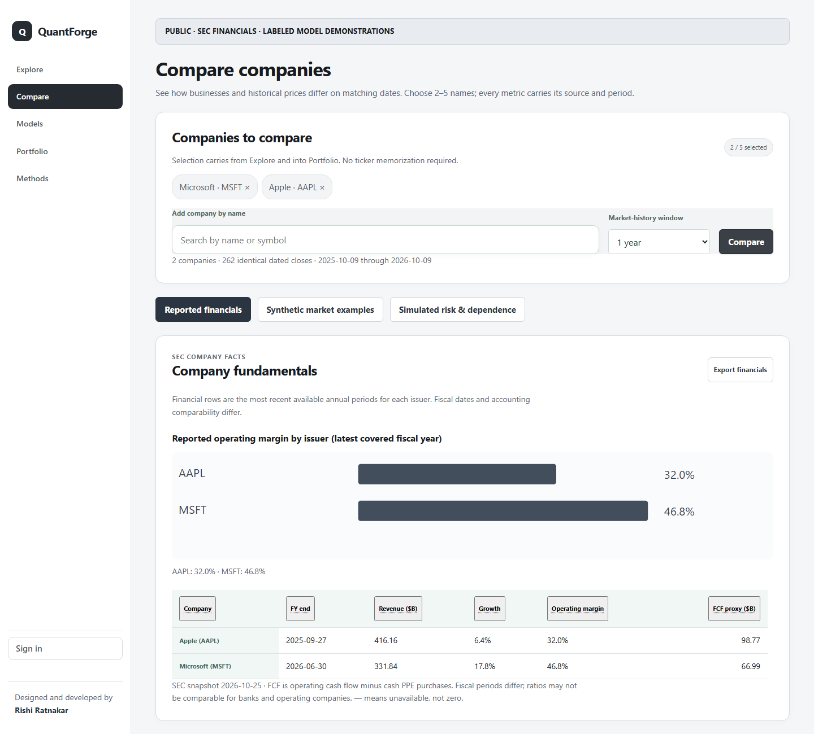

# QuantForge — Financial Research Platform

Full-stack financial research platform integrating SEC data engineering, machine learning, statistical modeling, valuation, and portfolio analytics. Built to make the inputs, calculations and limits of an investment research judgment inspectable.

[Open the application](https://quantforge-648.pages.dev/) · [Product](docs/current/PRODUCT.md) · [Architecture](docs/current/ARCHITECTURE.md) · [Methods](docs/current/METHODOLOGY.md) · [Technical walkthrough](docs/current/TECHNICAL_INTERVIEW_GUIDE.md) · [Release evidence](docs/current/RELEASE_STATUS.md)

## Two clear data modes

**Public:** real SEC financial statements with filing lineage, alongside explicitly labeled synthetic market-path experiments. Anyone can explore the methods without credentials. Synthetic paths are not observed company stock prices.

**Private:** owner authentication and Supabase authenticator MFA protect entitled Alpaca data, saved research and the persisted virtual account. Public source code does not grant access to that account or its data. **No live trading:** virtual transactions never submit real-money orders.



*Actual Public interface. Companies can have different fiscal periods and accounting conventions; financial ratios are research evidence, not an investment ranking. [Screenshot provenance](docs/images/README.md).*

## What the application does

| Section | Research workflow |
| --- | --- |
| Explore | Search by name; inspect financial trends, filing accessions, balance-sheet evidence and a company assessment |
| Compare | Compare 2–5 companies using dated financials, common-date paths, distributions, correlations and safe CSV exports |
| Models | Prediction, Risk, Valuation and Strategy Testing, each with Results, Evaluation and Method views |
| Portfolio | Review a virtual account, test What If? scenarios and inspect constrained allocation, covariance and Monte Carlo results |
| Methods | Trace sources, calculations, evaluation and software architecture through worked examples and technical evidence |

Private uses the same **Explore, Compare, Models, Portfolio and Methods** navigation as Public. Explore opens the clean Research home with authenticated company search, individual analysis and **Discover companies**. Discovery retains financial screening and sequential 1–5-company studies (three selected by default). Coverage is separate from investment disposition; missing evidence stays missing. Portfolio retains the saved virtual account, dated marks, risk, allocation and secure hypothetical transactions.

The primary assessment presents a conclusion, up to three supporting findings, up to three concerns and a specific next step. Detailed financial, valuation, risk, model, portfolio and source evidence remains expandable. Optional valuation and portfolio constraints are explicit assumptions; the app does not infer suitability or execute decisions.

## Engineering and quantitative evidence

| Area | Implementation | Checks |
| --- | --- | --- |
| SEC data engineering | [Snapshot extraction](tools/build_public_sec_snapshot.py), [financial transformations](web/site/sec_analytics.js) | [Source validation](tests/test_public_sec_snapshot.py), [metric fixtures](web/tests/sec_analytics.test.cjs) |
| Statistical ML | [L2 five-session direction classifier](web/site/private_predictive_ml_v180.js) | [Chronological training, mature labels and baselines](web/tests/private_predictive_ml_v180.test.cjs) |
| Statistics and scenarios | [Returns, volatility, VaR/ES, drawdown, moving blocks and DCF](web/site/research_models_core_v22.js) | [Numerical and input guards](web/tests/research_models_core_v22.test.cjs) |
| Optimization and backtesting | [Constrained allocation](web/site/private_optimizer.js), [rolling evaluation](web/site/private_walkforward_v65.js) | [Optimizer](web/tests/private_optimizer.test.cjs), [walk-forward](web/tests/private_research_v65.test.cjs) |
| Canonical research policy | [One assessment authority](web/site/research_decision_v34.js), [independent company studies](web/site/research_study_v35.js) | [Financial decision cases](web/tests/research_refinement_v36.test.cjs), [batch lifecycle](web/tests/definitive_batch_v35.test.cjs) |
| API and accounting | [FastAPI](cloud/api.py), [same-origin proxy](functions/api/[[path]].js) | [Owner/MFA/API](tests/test_hosted_web.py), [recorded-value accounting](tests/test_valuation_snapshots.py) |
| Archived experimental NLP | [TF-IDF, cosine topics and lexical tone](cloud/news_intelligence_v180.py) | [Text and endpoint fixtures](tests/test_news_intelligence_v180.py); retired from normal product views |

Local application acceptance passed **651 Python tests, 500 JavaScript tests, all 18 browser scripts and seven offline engine demonstrations**. Browser checks cover Chromium, Firefox and WebKit, five widths, keyboard interactions, session races, partial-source failures and accounting safeguards. Required exact-head CI and actual production checks are separate release gates. See [Actions](https://github.com/RishiRatnakarData/quantforge-hosted/actions/workflows/ci.yml) and [release status](docs/current/RELEASE_STATUS.md) for their scope.

## Architecture

```text
SEC Company Facts -> validated annual snapshot -> Public financial research
Synthetic paths   -> reproducible Public numerical experiments

Browser -> Cloudflare Pages / same-origin Functions -> FastAPI on Vercel Hobby
                                                     |-- owner + MFA verification
                                                     |-- Supabase owner state / RLS
                                                     `-- entitled Alpaca data

Eligible inputs -> retained pure engines -> canonical assessment -> shared UI
```

Native JavaScript and MathML keep the interface and equations inspectable. The deterministic site build retains three CSP-hashed scripts. Provider credentials and owner records stay outside public assets. The research workflow has no account writers. Decimal accounting, owner versions, replay checks, fees and quote-freshness checks protect virtual transactions.

## Run the Public interface locally

Use Python 3.11 or 3.12 for the tested environment, plus Node.js for JavaScript tests. From a clean clone on macOS/Linux:

```bash
python3.12 -m venv .venv
source .venv/bin/activate
python -m pip install -e ".[dev]"
python tools/build_unified_site.py
python -m http.server 8000 --bind 127.0.0.1 --directory public
```

On Windows PowerShell, use the environment's executable directly:

```powershell
py -3.12 -m venv .venv
.\.venv\Scripts\python.exe -m pip install -e ".[dev]"
.\.venv\Scripts\python.exe tools/build_unified_site.py
.\.venv\Scripts\python.exe -m http.server 8000 --bind 127.0.0.1 --directory public
```

Open `http://127.0.0.1:8000/`. This previews Public without provider credentials. Private requires the separately configured authenticated API; a local static server does not provide it. Deployment configuration is documented in [deployment, security and rollback](docs/current/DEPLOYMENT_SECURITY_ROLLBACK.md). Do not place live credentials or private records in source.

## Reproduce checks

With the environment activated:

```bash
python -m ruff check .
python -m pytest -q
node --test web/tests/*.test.cjs
python tools/build_unified_site.py
python tools/audit_public_bundle.py
python tools/prepublish_check.py
```

In PowerShell, use `node --test (Get-ChildItem web/tests -Filter '*.test.cjs' | ForEach-Object FullName)` for the JavaScript suite. Browser tests use Playwright 1.57.0 with Chromium, Firefox and WebKit; the [CI workflow](.github/workflows/ci.yml) lists the exact installation and all 18 script commands. Automated account activity uses isolated fixtures. Real-owner verification is read-only, with credential/MFA entry under the owner's control.

## Research limits

The five-session classifier is supplementary evidence, not a calibrated profit probability or authority for a multi-year entry or exit. Held-out Brier error and baseline comparisons do not establish profitable investing. The current snapshot lacks the original-as-of and delisting-aware history needed to claim economic outperformance for the shortlist policy. [Policy evidence](docs/current/INVESTMENT_POLICY_EVIDENCE.md) explains what is and is not evaluated, with an optional offline forward-paper protocol.

Annual cash-flow proxy means operating cash flow minus capital spending. Scenario DCF is distinct from verified FCFF, enterprise-to-diluted-equity value and a fair share price. Unsupported TTM, full capital claims, fund look-through and missing cost basis remain unavailable. Portfolio deposits are contributed capital, not gains; no unrecorded historical account returns are fabricated. Independent filing-archive and official factor engines remain available offline; the hosted UI has no file-upload controls.

## Source and documentation

The source repository is public by owner authorization. No new source license or provider-data redistribution permission has been selected. Authenticated records and entitled observations are not public examples. Security-sensitive credentials belong in the existing deployment secret stores.

Start with the [current documentation index](docs/README.md). [Historical release records](docs/history/releases/README.md) preserve development traceability; they are not current production instructions. The [technical walkthrough](docs/current/TECHNICAL_INTERVIEW_GUIDE.md) includes a five-minute demonstration and defensible discussion of methods, implementation and limitations.
