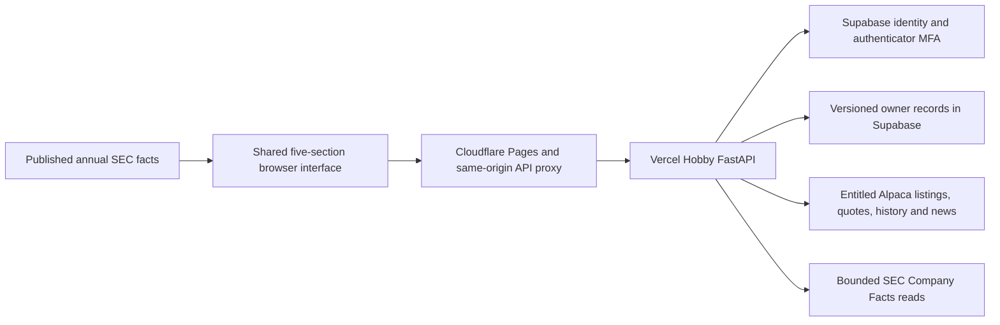

# Current architecture

Authoritative for the consolidated QuantForge 2.0 application. Historical Render and local-only documents are development records, not current operating instructions.

Public research runs from published SEC statements and clearly labeled deterministic market demonstrations. Public code never needs owner credentials. Private access uses the same interface with an unmistakable mode banner, owner verification and authenticated provider observations. Losing provider access withholds dependent results; it does not replace them with synthetic prices.

The browser sends same-origin requests to Pages Functions. The proxy validates an exact configured upstream origin, removes client-supplied privileged headers, supplies its server-side authentication header and restricts origin, cookies and forwarded responses. FastAPI independently verifies the proxy and owner session. Supabase MFA assurance remains required; a remembered browser preference only requests restoration of an existing server-verified session.

`research_app_v20.js` owns the selected company, revision, market history and shared basket. Analyze awaits its pending history request and checks that company, mode, account version and run token still match. `research_deep_v25.js` adapts retained numerical specialists. Identical in-flight company studies share one promise; changed context invalidates displayed and pending evidence.

`research_guide_v30.js` explains sourced evidence. `research_decision_v34.js` adds the single current assessment, explicit optional research conditions and traceable coverage. `research_workspace_v34.js` supplies My Briefing, Research an Investment and My Portfolio without adding a sixth Public route or another account store. Its new operations are read-only. Temporary conditions and reviewed assessments clear when Private mode ends.

The eligible universe is the intersection of bundled SEC company coverage and the existing hourly cached Alpaca active/tradable US listing catalogue. One protected metadata request supports local financial filtering; it does not fetch prices for every issuer or claim whole-market coverage. Each shortlisted name still requires individual market, valuation and portfolio research.

Supabase records preserve notes, thesis revisions, holdings, basis, transactions and owner-requested valuation marks. Writes retain expected-version and request-replay protection. New briefing code never invokes account writers. Existing virtual transactions require an explicit server preview and confirmation; this application does not submit real-money orders.

The hosted API package is deliberately small. `tools/package_vercel_api.py` permits named runtime files and records clean Git revision and file hashes. Offline Python forecasting, GARCH, options and integrated research remain available in the repository and CLI; they are not all server-hosted models.

Source: [browser orchestration](../../web/site/research_app_v20.js), [deep adapter](../../web/site/research_deep_v25.js), [assessment](../../web/site/research_decision_v34.js), [API](../../cloud/api.py), [proxy](../../functions/api/[[path]].js), [package manifest builder](../../tools/package_vercel_api.py).
